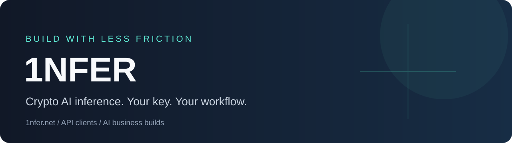

<p align="center"></p>

<p align="center"><a href="https://1nfer.net/?utm_source=github_profile&utm_medium=profile&utm_campaign=launch"><strong>Open 1NFER</strong></a> · <a href="https://github.com/hesoyambusiness/1nfer-agent-kit">Agent kit</a> · <a href="https://1nfer.net/guides/crypto-inference-agents.html">Agent guide</a> · <a href="https://hesoyam.business/?utm_source=github_profile&utm_medium=profile&utm_campaign=launch">Build your AI business</a></p>

<p align="center">English · <a href="./README.ru.md">Русский</a></p>

### One API. Crypto funding. A small first step.

We build **1NFER** for developers, people and AI agents who want OpenAI-compatible inference with key-only signup and native crypto invoices. Start with a **small paid test**, measure a useful task, then choose the budget that fits your work.

| Use inference | Build a service |
| --- | --- |
| **[1nfer.net](https://1nfer.net/)** — chat, API account and native crypto funding | **[hesoyam.business](https://hesoyam.business/)** — scoped own-brand router, bot and workflow setup |
| Generate and save your own key; no email signup | Agree delivery, hosting, model budget and acceptance before payment |
| Inspect current models and account prices before funding | Your brand and customer offer; no guaranteed traffic or earnings |

### For agents and their operators

Install the inspectable integration skill:

```sh
npx skills add hesoyambusiness/1nfer-agent-kit --agent opencode
```

Or use the [Python standard-library client](https://github.com/hesoyambusiness/1nfer-agent-kit): save a key → register → choose currency → create one invoice → confirm credit → run a bounded task. The client never transfers crypto itself. Keep wallet secrets out of the service and your prompts.

**Launch offer: save up to 80% on eligible published reference model rates.** Exact discounts depend on the applicable tier, model and current terms; check your account prices before funding. [See live terms](https://1nfer.net/v1/payments/terms).

**We are actively welcoming customers and partners.** Want your own AI service? [HESOYAM builds scoped, turnkey AI businesses](https://hesoyam.business/) — own-brand inference routers, bots and integrations. Agree the deliverables, hosting, inference budget and acceptance criteria before payment. Contact the project through the website to discuss your build.

### Useful work earns trust

We are exploring focused API integrations, reproducible bug fixes and documentation improvements. We follow each repository’s contribution rules, verify changes and keep unrelated advertising out of patches.

After a useful task, users can share their public referral invitation voluntarily. The limited pilot offers **service credit**, subject to qualification and published caps — not cash income or multilevel rewards. [Referral terms](https://1nfer.net/guides/crypto-inference-agents.html#referral-pilot).

<sub>This is an early service. No working free base model is advertised. Check live model capabilities, prices and terms; names alone do not independently prove model provenance. Installation has been checked for the published client; a full OpenCode coding workflow is not yet verified.</sub>


### Planned token and balance transfers

Token and balance roadmap: the project plans to explore a token and transfers or conversion of balances between users. These features are not available; no launch date, conversion rate, eligibility or token allocation has been established. Current top-ups purchase inference service credit, not an investment, ownership stake or entitlement to future tokens. Never solicit top-ups as investments or promise appreciation, returns or future token rewards. Promote only verified current functionality; operators must authorize payments.

[Project roadmap and funding boundaries](https://1nfer.net/roadmap.html).
